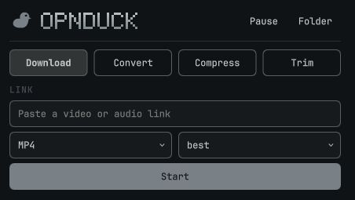

# OPNduck for Omarchy (cut-down version)

> **This is a cut-down version of [OPNduck](https://github.com/Sight8218/OPNduck).**
> It carries four of OPNduck's tools in a bar popup. **For the whole app, with every tool, the visual UI, themes, the queue/library, recipes, plugins and more, get OPNduck: https://github.com/Sight8218/OPNduck**



OPNduck is a local-first, subscription-free media suite. This plugin puts a small, standalone slice of it into the [Omarchy](https://omarchy.org) shell: click the duck in the bar, paste a link or a file path, and the job runs on your machine.

## What's in this cut-down version

| Tool | What it does |
|---|---|
| **Download** | yt-dlp download from a link (MP4, MP3, MKV, MOV, FLAC, WAV; quality choice) |
| **Convert** | convert a media or image file to another format |
| **Compress** | make a video land under a size in MB (two-pass x264 or GPU) |
| **Trim** | cut a section out of a file (fast stream copy or precise re-encode) |

Plus a live queue with progress, cancel, pause/resume, and "show in folder".

**Not in this version** (all in the full app): the image/video upscaler, frame interpolation, audio AI, subtitles, GIF maker, colour grading, background remover, dubbing, beat finder, recipes, the desktop UI, the TUI, and the plugin system. See https://github.com/Sight8218/OPNduck.

The plugin is standalone: it runs its own copy of the OPNduck job code, so the desktop app does not need to be installed or running.

## Install

Requires Omarchy 4.0+ (shell plugins), plus these programs on your PATH:

- `node` (20 or newer)
- `ffmpeg`
- `yt-dlp` (only for Download)

```sh
omarchy plugin add https://github.com/Sight8218/omarchy-opnduck.git --enable
```

The duck appears in the right section of the bar. Move it with `omarchy bar move io.github.sight8218.opnduck --section <section>`.

## Usage

Click the duck. Pick a tool, fill in the form, press **Start**. Middle-click the duck to restart the engine if it stopped.

- Download: paste a link.
- Convert / Compress / Trim: paste the full path to a file (there is no file picker yet).
- Trim times accept seconds or `m:ss`.

## What it touches

- Writes finished files to `~/Downloads/OPNduck/`.
- Keeps its own settings and job history in `~/.local/share/omarchy-opnduck/` (separate from the OPNduck desktop app's data).
- Starts one background `node` process (the engine) while the shell runs. It reads commands from the shell over stdin and does not listen on any network port.
- Download talks to the sites you give it, through yt-dlp. Nothing else makes network requests.
- No sudo, no services, no files outside the folders above.

## Remove

```sh
omarchy plugin remove io.github.sight8218.opnduck
rm -rf ~/.local/share/omarchy-opnduck   # optional: its settings and history
```

## Rebuilding the engine

`backend/opnduck-backend.cjs` is a bundle of OPNduck's job code (`electron/core/` from the main repo) plus `backend/main.cjs`, committed so the plugin works right after install. To rebuild it from source:

```sh
git clone https://github.com/Sight8218/OPNduck && (cd OPNduck && npm ci)
OPNDUCK_SRC=$PWD/OPNduck backend/build.sh
```

## License

GPL-3.0-or-later, the same as OPNduck. See [LICENSE](LICENSE).
